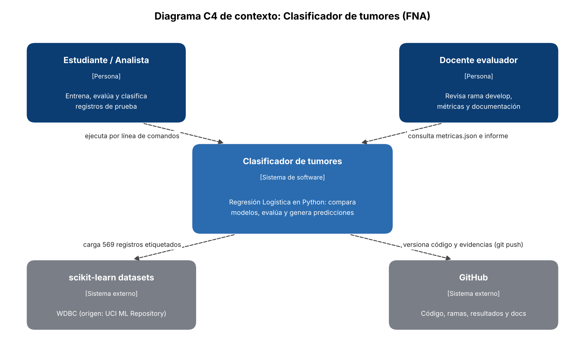

# proyectoFinal_clasificacionTumores

**Autor:** Malory Numpaque · **Curso:** Teoría de la Computación II, Universidad de La Salle · **Actividad 6:** Mini-proyecto (trabajo individual)

Clasificador académico que estima si un tumor de mama es **maligno o benigno** a partir de medidas de núcleos celulares. Compara un modelo de referencia con tres modelos básicos de Machine Learning, evalúa el resultado con métricas cuantitativas y analiza sus implicaciones éticas.

El desarrollo completo (dataset, interpretación de métricas, matriz de confusión y análisis ético) está en [`docs/informe_mini_proyecto.pdf`](docs/informe_mini_proyecto.pdf).

> **Uso exclusivamente académico.** Este sistema no es un dispositivo médico y no debe usarse para diagnosticar personas.

## 1. Qué problema se resuelve

En un diagnóstico de cáncer, el peor error es clasificar como benigno un tumor maligno (falso negativo). El proyecto responde: ¿puede un modelo sencillo e interpretable separar ambos casos en este dataset, con pocos falsos negativos y mejor que una regla trivial?

## 2. Con qué datos

**Breast Cancer Wisconsin (Diagnostic)**, cargado desde `sklearn.datasets.load_breast_cancer` (origen: UCI Machine Learning Repository, licencia CC BY 4.0).

| Aspecto | Valor |
|---|---|
| Registros | 569 (212 malignos, 357 benignos) |
| Variables de entrada | 30 numéricas, calculadas sobre imágenes de aspiración con aguja fina (FNA) |
| Valores faltantes | Ninguno |
| Objetivo | `maligno`: 1 = maligno, 0 = benigno |

Por cada una de 10 características del núcleo (radio, textura, perímetro, área, suavidad, compacidad, concavidad, puntos cóncavos, simetría y dimensión fractal) hay tres medidas: media, error estándar y peor valor. scikit-learn codifica 0 = maligno, así que `src/datos.py` invierte la etiqueta para que las métricas se refieran a detectar el caso maligno.

## 3. Cómo funciona

1. **Carga y división:** 80 % entrenamiento (455) y 20 % prueba (114), estratificada, con semilla 42.
2. **Selección de modelo:** validación cruzada estratificada de 5 pliegues, solo sobre entrenamiento.
3. **Entrenamiento:** escalado y Regresión Logística dentro de un mismo `Pipeline`.
4. **Calibración del umbral:** el mayor umbral con recall ≥ 0,97 en predicciones fuera de pliegue de entrenamiento (resultado: 0,315).
5. **Evaluación:** métricas, intervalo de confianza del recall y matriz de confusión en prueba.
6. **Predicción:** `src/predecir.py` clasifica un CSV y rechaza columnas o valores faltantes.

```bash
python -m venv .venv && source .venv/bin/activate
pip install -r requirements.txt
python -m src.entrenar_evaluar        # genera resultados/
python -m pytest -q                   # 9 pruebas
python -m src.predecir entrada.csv salida.csv
```

## 4. Alcance

| El sistema hace | El sistema no hace |
|---|---|
| Entrena y compara cuatro modelos sobre un dataset público | Diagnosticar pacientes ni reemplazar a un profesional de salud |
| Reporta métricas, matriz de confusión y criterios de aceptación | Procesar imágenes: recibe las 30 medidas ya calculadas |
| Clasifica por lotes un CSV con las columnas esperadas | Exponer una API, una interfaz web o despliegue en la nube |
| Rechaza entradas incompletas | Imputar datos, reentrenarse solo o manejar datos reales de pacientes |
| | Medir equidad por grupos: el dataset no tiene variables demográficas |

## 5. Diagrama C4 de contexto



## 6. Decisiones de arquitectura (ADR)

### ADR-001. Enfoque de implementación: scripts de Python por lotes
- **Contexto:** se necesita un flujo repetible y revisable mediante commits.
- **Decisión:** módulos Python ejecutados por línea de comandos, con scikit-learn y pruebas en pytest.
- **Alternativas:** un notebook (salidas difíciles de revisar en commits y orden de ejecución no garantizado) y Amazon SageMaker (costo y dependencia del laboratorio, innecesarios para 569 filas).
- **Consecuencias:** cualquier persona reproduce todo con dos comandos. No hay interfaz gráfica.

### ADR-002. Selección de modelo: Regresión Logística con umbral calibrado
- **Contexto:** prima detectar malignos y poder explicar el resultado.
- **Decisión:** Regresión Logística con regularización L2 por defecto, elegida por tener el mayor recall y F1 en validación cruzada; umbral calibrado a 0,315 usando solo entrenamiento.
- **Alternativas:** Árbol de Decisión (F1 0,890 y recall 0,865 en validación cruzada) y KNN (F1 0,951 y recall 0,918, sin coeficientes interpretables).
- **Consecuencias:** coeficientes inspeccionables y salida probabilística ajustable. Asume una frontera lineal, y bajar el umbral puede aumentar los falsos positivos.

### ADR-003. Almacenamiento y despliegue: artefactos locales versionados
- **Contexto:** es un ejercicio académico sin usuarios en producción.
- **Decisión:** el dataset se carga desde scikit-learn; métricas en JSON/CSV y modelo con su umbral en `resultados/modelo.joblib`. Sin despliegue en servidor.
- **Alternativas:** API con endpoint en la nube, y almacenamiento en S3.
- **Consecuencias:** sin costos ni exposición de un servicio. El `.joblib` depende de la versión de scikit-learn; si no carga, se regenera con `python -m src.entrenar_evaluar`.

## 7. Calidad y evaluación del modelo

**Separación de datos:** 80/20 estratificada. La comparación de modelos y la calibración del umbral usan solo entrenamiento.

**Validación cruzada (media de 5 pliegues, entrenamiento):**

| Modelo | Accuracy | Precision | Recall | F1 |
|---|---:|---:|---:|---:|
| Referencia (clase mayoritaria) | 0,626 | 0,000 | 0,000 | 0,000 |
| **Regresión Logística** | **0,974** | **0,977** | **0,953** | **0,964** |
| Árbol de Decisión | 0,921 | 0,920 | 0,865 | 0,890 |
| KNN (k=5) | 0,965 | 0,988 | 0,918 | 0,951 |

**Conjunto de prueba (114 registros, 42 malignos):**

| Modelo | Accuracy | Precision | Recall | F1 | VP | FP | VN | FN |
|---|---:|---:|---:|---:|---:|---:|---:|---:|
| Referencia (clase mayoritaria) | 0,632 | 0,000 | 0,000 | 0,000 | 0 | 0 | 72 | 42 |
| Regresión Logística, umbral 0,5 | 0,965 | 0,975 | 0,929 | 0,951 | 39 | 1 | 71 | 3 |
| **Regresión Logística, umbral 0,315** | **0,974** | **0,976** | **0,952** | **0,964** | **40** | **1** | **71** | **2** |

**Criterios de aceptación** (definidos antes de evaluar en prueba):

| Criterio | Umbral 0,5 | Umbral 0,315 |
|---|---|---|
| Recall ≥ 0,95 | No cumple (0,929) | Cumple (0,952) |
| F1 ≥ 0,93 | Cumple | Cumple |
| F1 mayor que el del modelo de referencia | Cumple | Cumple |
| **Decisión** | **Rechazado** | **Aceptado** |

**Criterios de aceptación del software:** las 9 pruebas de `tests/` verifican codificación de la clase positiva, ausencia de fuga entre conjuntos, estratificación, reproducibilidad, validación de entrada y cumplimiento de los criterios.

**Por qué estos resultados son válidos, y hasta dónde:** el modelo de referencia muestra que un accuracy de 63 % se logra sin detectar ningún maligno, y por eso se prioriza el recall. El umbral se calculó sin usar prueba, pero el conjunto de prueba ya se había consultado una vez con el umbral 0,5, así que la segunda medición no es completamente independiente. Además, 40 de 42 aciertos dan un intervalo de confianza del 95 % (Wilson) para el recall de **84,2 % a 98,7 %**. Una validación externa sigue pendiente.

## 8. Riesgos técnicos

| # | Riesgo | Impacto | Mitigación |
|---|---|---|---|
| 1 | Datos insuficientes: solo 42 malignos en prueba | Alto: incertidumbre amplia en el recall | Validación cruzada, intervalo de confianza y recomendación de validación externa |
| 2 | Fuga de información entre conjuntos | Alto: métricas infladas | Escalado dentro del `Pipeline`, umbral calculado sin prueba, pruebas de disyunción; se declara el uso repetido de prueba |
| 3 | Sobreajuste | Medio: peor desempeño con datos nuevos | Regularización L2, validación cruzada; F1 de 0,982 en entrenamiento frente a 0,951 en prueba con umbral 0,5 |
| 4 | Sesgos y falta de representatividad | Alto: desempeño desigual en otras poblaciones | Sin uso clínico; auditoría por subgrupos con datos que incluyan variables demográficas |
| 5 | Limitaciones de cómputo y versiones | Bajo: el entrenamiento es liviano, pero el artefacto depende de la versión | `requirements.txt`, semilla fija y regeneración del modelo por comando |

## 9. Glosario

| Término | Definición |
|---|---|
| Accuracy | Proporción total de predicciones correctas |
| ADR | Registro de una decisión de arquitectura, con su contexto y consecuencias |
| C4 | Modelo para diagramar arquitectura de software en niveles; el de contexto muestra usuarios y sistemas externos |
| F1-Score | Media armónica de precision y recall |
| FNA | Aspiración con aguja fina, procedimiento del que provienen las imágenes |
| Fuga de información | Uso, durante el entrenamiento, de información que no estaría disponible al predecir |
| Modelo de referencia | Modelo trivial que fija el desempeño mínimo a superar |
| Precision | De los casos predichos malignos, proporción realmente maligna |
| Recall | De los casos realmente malignos, proporción detectada |
| Regresión Logística | Modelo lineal que estima la probabilidad de pertenecer a una clase |
| Sobreajuste | El modelo aprende particularidades de entrenamiento y generaliza peor |
| Umbral | Probabilidad a partir de la cual un caso se clasifica como maligno |
| Validación cruzada | Evaluación repetida rotando la parte de los datos usada para validar |

## 10. Referencias

**Dataset**
- Wolberg, W., Mangasarian, O., Street, N. y Street, W. (1993). *Breast Cancer Wisconsin (Diagnostic)* [Dataset]. UCI Machine Learning Repository. https://doi.org/10.24432/C5DW2B
- Street, W. N., Wolberg, W. H. y Mangasarian, O. L. (1993). Nuclear feature extraction for breast tumor diagnosis. *Biomedical Image Processing and Biomedical Visualization, 1905*, 861-870. SPIE.

**Herramientas**
- Pedregosa, F. et al. (2011). Scikit-learn: Machine Learning in Python. *Journal of Machine Learning Research, 12*, 2825-2830.

**Decisiones técnicas**
- Brown, S. (s.f.). *The C4 model for visualising software architecture*. https://c4model.com/
- Nygard, M. (2011). *Documenting Architecture Decisions*. https://www.cognitect.com/blog/2011/11/15/documenting-architecture-decisions

**Ética y normativa**
- Congreso de Colombia. (2012). *Ley Estatutaria 1581 de 2012*.
- Obermeyer, Z., Powers, B., Vogeli, C. y Mullainathan, S. (2019). Dissecting racial bias in an algorithm used to manage the health of populations. *Science, 366*(6464), 447-453. https://doi.org/10.1126/science.aax2342
- UNESCO. (2021). *Recomendación sobre la ética de la inteligencia artificial*. https://unesdoc.unesco.org/ark:/48223/pf0000381137
